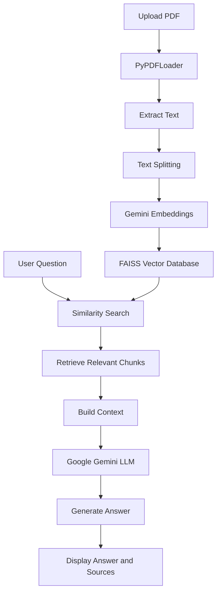

# 📚 Chat_with_Docs – AI-Powered PDF Chatbot

**Chat_with_Docs** is an AI-powered PDF chatbot that allows users to interact with their PDF documents using natural language. Instead of manually searching through lengthy documents, users can upload a PDF and ask questions to receive relevant, context-based answers.

Built using **Python, Streamlit, LangChain, FAISS, and Google Gemini**, Chat_with_Docs uses Retrieval-Augmented Generation (RAG) to retrieve relevant information from uploaded documents and generate meaningful responses.

---

## 🚀 Live Demo

**Try Chat_with_Docs:** https://chatwithdocs-sainky.streamlit.app

---

## ✨ Key Features

- 📄 **PDF Upload:** Upload PDF documents and interact with their content.
- 🤖 **AI-Powered Chatbot:** Ask questions about uploaded documents using natural language.
- 🔍 **Semantic Search:** Retrieve relevant document sections using vector similarity search.
- 🧠 **RAG Architecture:** Generate answers based on retrieved document context.
- ⚡ **Google Gemini Integration:** Use Google's Gemini models for AI-powered responses and embeddings.
- 📌 **Source References:** Display source document and page information to help locate relevant content.
- 💬 **Interactive Chat Interface:** Chat with your documents through a Streamlit-based interface.
- 🌌 **Modern UI:** Space-inspired interface with animated stars and custom chatbot/user logos.

---

## 🛠️ Technologies Used

| Technology | Purpose |
|---|---|
| Python | Core programming language |
| Streamlit | Web application interface |
| LangChain | Document processing and RAG pipeline |
| Google Gemini | AI-powered answer generation |
| Gemini Embeddings | Convert text into vector representations |
| FAISS | Vector storage and similarity search |
| PyPDF | PDF document loading and text extraction |
| RecursiveCharacterTextSplitter | Divide documents into manageable chunks |
| Python-dotenv | Manage environment variables |

---

## 🧠 How Chat_with_Docs Works

Chat_with_Docs follows a **Retrieval-Augmented Generation (RAG)** architecture.

### RAG Workflow

1. **PDF Upload:** The user uploads a PDF document.
2. **Text Extraction:** PyPDFLoader extracts text from the PDF.
3. **Text Chunking:** RecursiveCharacterTextSplitter divides the extracted text into smaller chunks.
4. **Text Embedding:** Google Gemini Embeddings convert text chunks into numerical vectors.
5. **Vector Storage:** FAISS stores the generated vectors for efficient similarity searching.
6. **Question Processing:** The user enters a question in the chatbot.
7. **Similarity Search:** FAISS retrieves the most relevant document chunks.
8. **Context Generation:** The retrieved chunks are combined into context for the language model.
9. **AI Response:** Google Gemini generates an answer based on the retrieved context.
10. **Source Reference:** Relevant source document and page information are provided with the answer.

### Architecture Diagram



---

## 📂 Project Structure

```text
Chat_with_Docs/
│
├── app.py                 # Main Streamlit application
├── requirements.txt       # Python dependencies
├── .env                   # Gemini API key (not uploaded to GitHub)
├── .gitignore             # Files excluded from Git
├── README.md              # Project documentation
│
└── faiss_index/           # Locally generated FAISS index (if present)
```

---

## ⚙️ Installation and Setup

Follow these steps to run Chat_with_Docs on your local machine.

### 1. Clone the Repository

```bash
git clone https://github.com/Sainky-gupta/Chat_with_Docs.git
```

### 2. Navigate to the Project Directory

```bash
cd Chat_with_Docs
```

### 3. Create a Virtual Environment

```bash
python -m venv venv
```

### 4. Activate the Virtual Environment

**Windows:**

```bash
venv\Scripts\activate
```

**Linux / macOS:**

```bash
source venv/bin/activate
```

### 5. Install Dependencies

```bash
pip install -r requirements.txt
```

### 6. Configure Your Gemini API Key

Create a `.env` file in the root project directory.

Add your Google Gemini API key:

```env
GOOGLE_API_KEY=your_gemini_api_key
```

Get your API key from:

https://aistudio.google.com/apikey

**Important:** Never upload your `.env` file or expose your API key publicly.

### 7. Run the Application

```bash
streamlit run app.py
```

The application will open in your browser, usually at:

```text
http://localhost:8501
```

---

## 🔑 Environment Variables

Chat_with_Docs requires the following environment variable:

| Variable | Description |
|---|---|
| `GOOGLE_API_KEY` | Google Gemini API key used for embeddings and AI responses |

For local development, configure it in `.env`.

For Streamlit Cloud, configure it under **App Settings
